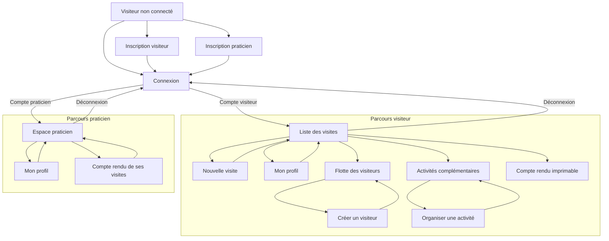

# OXAM LABO — Gestion des visites médicales

Application web PHP/MySQL de suivi des visites de visiteurs médicaux, de leur portefeuille de praticiens et des activités complémentaires (AC).

## Fonctionnalités

- Création d'un profil visiteur et affectation à une région.
- Inscription d'un compte praticien avec email, mot de passe et spécialité (choix ou ajout).
- Connexion et déconnexion, pour les visiteurs **et** les praticiens (un seul formulaire, email unique sur toute l'application).
- Espace praticien : profil personnel et liste des visites dont il est le praticien.
- Consultation de la flotte des visiteurs.
- Création et consultation des comptes rendus de visite.
- Association de praticiens, de médicaments présentés et d'échantillons à une visite.
- Sélection de tous les praticiens enregistrés lors de la saisie d'une visite.
- Consultation et création d'activités complémentaires.
- Affichage d'un compte rendu de visite dans une page imprimable (action « PDF » dans l'interface), limité au visiteur émetteur ou au praticien concerné.

> **Authentification :** visiteurs et praticiens se connectent avec leur adresse e-mail **et leur mot de passe** (haché en bcrypt via `password_hash`). Chaque adresse email ne peut créer qu'un seul compte, quelle que soit sa nature. Les pages de visites, d'activités et de gestion des visiteurs sont réservées aux sessions de type visiteur ; l'espace praticien est réservé aux sessions de type praticien. Cette application est un projet de démonstration et ne doit pas être exposée en production sans renforcer l'authentification et la sécurité (par exemple : limitation des tentatives de connexion, réinitialisation de mot de passe, HTTPS).

## Technologies et prérequis

- PHP 8.x avec les extensions PDO, PDO MySQL (`pdo_mysql`) et `mbstring`.
- MySQL ou MariaDB.
- Apache (par exemple via Laragon).
- Un navigateur web récent.

Aucun gestionnaire de dépendances ni aucune bibliothèque externe n'est requis par le code actuellement fourni.

## Installation locale avec Laragon

1. Placez le projet dans le dossier web de Laragon, par exemple `C:\laragon\www\oxam_labo`.
2. Démarrez Apache et MySQL depuis Laragon.
3. Créez et initialisez la base de données en important [`schema.sql`](schema.sql) dans MySQL, par exemple avec HeidiSQL. Ce script crée la base `oxam_labo`, ses tables et des données de démonstration. Il est destiné à une installation neuve : ne le réimportez pas dans une base déjà initialisée.
4. Vérifiez les paramètres de connexion dans [`config/database.php`](config/database.php). Les valeurs par défaut sont `localhost`, la base `oxam_labo`, l'utilisateur `root` et un mot de passe vide. Adaptez-les à votre installation MySQL.
5. Si la base existait déjà avant que `telephone_vis` soit défini comme texte, exécutez une fois [`migrations/001_telephone_vis_varchar.sql`](migrations/001_telephone_vis_varchar.sql). Cette migration convertit la colonne en `VARCHAR(20)` afin de conserver les zéros initiaux et d'accepter les numéros internationaux. Faites une sauvegarde de la base avant toute migration.
6. Si la base existait avant l'ajout du mot de passe des visiteurs, exécutez une fois [`migrations/002_visiteur_mot_de_passe.sql`](migrations/002_visiteur_mot_de_passe.sql). Elle ajoute la colonne `mot_de_passe_vis` et définit le mot de passe provisoire `oxam2025` pour les comptes déjà créés (à changer après la première connexion). Ce script est inutile sur une base créée à partir de `schema.sql`, qui inclut déjà cette colonne.
7. Si la base existait avant l'ajout du compte praticien, exécutez une fois [`migrations/003_practicien_compte.sql`](migrations/003_practicien_compte.sql). Elle ajoute `mail_par` et `mot_de_passe_par`, génère un email provisoire au format `prenom.nom@oxam-labo.fr` pour les praticiens déjà présents et leur attribue le mot de passe provisoire `oxam2025`. Comme pour la migration 002, ce script est inutile sur une base créée à partir de `schema.sql`.
8. Ouvrez l'application dans votre navigateur :
   - `http://oxam_labo.test/` si les hôtes virtuels automatiques de Laragon sont activés ;
   - sinon `http://localhost/oxam_labo/`.

## Première utilisation

Le script d'initialisation ajoute notamment les comptes de démonstration suivants (mot de passe `oxam2025`) :

- visiteurs : `jean.dupont@oxam-labo.fr`, `sophie.martin@oxam-labo.fr`
- praticiens : `luc.bernard@oxam-labo.fr`, `claire.moreau@oxam-labo.fr`

Pour créer un autre profil visiteur, utilisez **Créer un compte**, renseignez les coordonnées, choisissez une région et définissez un mot de passe d'au moins 8 caractères. Une inscription réussie ajoute le visiteur dans `Visiteur` (avec son mot de passe haché) et son affectation dans `Travailler`.

Un praticien peut utiliser **Créer un profil praticien** depuis la page de connexion. Il choisit une spécialité existante ou en ajoute une, renseigne son identité, son adresse, **une adresse email et un mot de passe** (8 caractères minimum). Son profil est ensuite disponible dans la liste des praticiens lors de la saisie d'une visite, et il peut se connecter à **l'espace praticien** (`index.php?action=practicien`) pour consulter son profil et les visites dont il est le praticien.

Une adresse email ne peut être utilisée que par un seul compte, visiteur ou praticien : l'inscription refuse les doublons même entre les deux tables. Les comptes créés avant la migration `003` (praticiens déjà présents en base) reçoivent un email provisoire `prenom.nom@oxam-labo.fr` et le mot de passe `oxam2025`, à corriger après la première connexion.

## Navigation

Le diagramme ci-dessous résume les parcours accessibles depuis l'interface. Après connexion, les liens proposés dépendent du rôle du compte.



Les pages sont routées par le paramètre `action` de `index.php` :

| Action | Description |
| --- | --- |
| `login` | Connexion (visiteur ou praticien) |
| `register` | Inscription d'un visiteur |
| `practicien_register` | Inscription d'un compte praticien |
| `practicien` | Espace praticien (profil et visites reçues) |
| `practicien_profil` | Consultation et modification du profil praticien |
| `logout` | Déconnexion |
| `visites` | Liste des visites du visiteur connecté |
| `visite_create` | Saisie d'une visite |
| `visite_delete&id=<id>` | Suppression d'une visite lorsque les règles métier le permettent |
| `visite_pdf&id=<id>` | Affichage du compte rendu imprimable (visiteur émetteur ou praticien concerné) |
| `visiteurs` | Liste des visiteurs |
| `visiteur_create` | Création d'un visiteur connecté |
| `visiteur_profil` | Consultation et modification du profil visiteur |
| `ac` | Liste des activités complémentaires |
| `ac_create` | Création d'une activité complémentaire |

Les pages de visites, d'activités et de gestion des visiteurs nécessitent une session de type visiteur. L'espace praticien nécessite une session de type praticien ; un visiteur qui tente d'y accéder est renvoyé vers ses visites et inversement. L'inscription des visiteurs et des praticiens est publique.

## Base de données

Le schéma de [`schema.sql`](schema.sql) comprend notamment les tables `Visiteur`, `Region`, `Travailler`, `Practicien`, `Specialite`, `Visite`, `Medicament`, `Presenter`, `Offrir` et `AC`, ainsi que les tables de liaison utilisées par le modèle.

Les régions et exemples de visiteurs, praticiens et médicaments sont insérés par le script d'initialisation. Les listes proposées dans l'application proviennent des données présentes dans la base.

Pour une base existante, les migrations `001_telephone_vis_varchar.sql`, `002_visiteur_mot_de_passe.sql` et `003_practicien_compte.sql` peuvent être exécutées dans HeidiSQL en ouvrant le fichier correspondant dans une fenêtre de requête et en exécutant le script sur le serveur MySQL.

## Structure du projet

```text
config/       Connexion à la base de données
controllers/  Contrôleurs des pages et des actions
migrations/   Migrations destinées aux bases existantes
models/       Accès aux données et opérations métier
public/       Feuilles de style et scripts JavaScript
tests/        Scripts de test (exécution en ligne de commande PHP)
views/        Pages PHP et gabarits HTML
index.php     Point d'entrée et routage
schema.sql    Création du schéma et données de démonstration
```

## Dépannage

- **Erreur de connexion à la base** : vérifiez que MySQL est démarré, que la base `oxam_labo` existe et que les identifiants de [`config/database.php`](config/database.php) sont corrects.
- **Aucune région dans le formulaire** : vérifiez que les données initiales de `Region` ont été importées dans la base utilisée par l'application.
- **Erreur à la création d'un compte avec un numéro de téléphone** : sur une base antérieure, exécutez la migration `001_telephone_vis_varchar.sql`, puis vérifiez que `telephone_vis` est de type `VARCHAR(20)`.
- **Connexion refusée avec un compte créé avant l'ajout du mot de passe** : exécutez la migration `002_visiteur_mot_de_passe.sql`, qui attribue le mot de passe provisoire `oxam2025` aux comptes existants.
- **Erreur SQL « Unknown column 'mot_de_passe_vis' »** : la colonne du mot de passe manque sur une base ancienne ; exécutez la migration `002_visiteur_mot_de_passe.sql`.
- **Erreur SQL « Unknown column 'mail_par' » ou un praticien ne peut pas se connecter** : exécutez la migration `003_practicien_compte.sql`, qui crée les colonnes de connexion du praticien et attribue email/mot de passe provisoires aux comptes existants.
- **Erreur de clé étrangère à la création d'un compte praticien (colonne `id_spe`)** : la spécialité choisie n'existe pas en base ; reprenez le formulaire (les spécialités proposées sont celles de votre base) ou ajoutez une spécialité dans le champ prévu à cet effet.
- **Erreur SQL persistante** : consultez le journal d'erreurs PHP configuré par votre installation PHP/Laragon (par défaut `C:/laragon/tmp/php_errors.log`). Les échecs de création de compte sont journalisés côté serveur.
