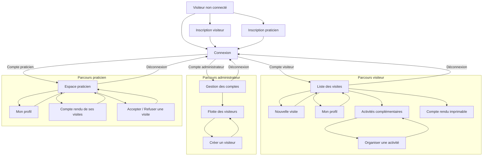

# OXAM LABO — Gestion des visites médicales

Application web PHP/MySQL de suivi des visites de visiteurs médicaux, de leur portefeuille de praticiens et des activités complémentaires (AC).

## Fonctionnalités

- Création d'un profil visiteur et affectation à une région.
- Inscription d'un compte praticien avec email, mot de passe et spécialité (choix ou ajout).
- Validation des nouveaux comptes praticiens par un administrateur avant leur connexion.
- Espace administrateur pour gérer les comptes visiteurs, praticiens et administrateurs : statut et suppression ; modification des informations et réinitialisation du mot de passe pour les administrateurs uniquement.
- Informations personnelles et mot de passe des visiteurs et des praticiens modifiables uniquement par eux-mêmes, depuis leur profil.
- Statuts de validation praticien modifiables depuis l'administration, avec protection du dernier administrateur actif.
- Saisie de la région du praticien à l'inscription, avec ajout automatique si elle est nouvelle.
- Connexion et déconnexion, pour les visiteurs **et** les praticiens (un seul formulaire, email unique sur toute l'application).
- Espace praticien : profil personnel et liste des visites dont il est le praticien, avec acceptation ou refus des visites en attente lorsqu'il n'est pas disponible.
- Suivi du statut des visites (`en_attente`, `acceptee`, `refusee`) : le visiteur voit le statut dans sa liste de visites et est averti sur son profil lorsqu'une visite a été refusée et n'aura pas lieu.
- Consultation de la flotte des visiteurs et création de visiteurs réservées à l'administrateur.
- Création et consultation des comptes rendus de visite.
- Association de praticiens, de médicaments présentés et d'échantillons à une visite.
- Sélection des praticiens approuvés lors de la saisie d'une visite.
- Consultation et création d'activités complémentaires par les visiteurs.
- Administration complète des activités complémentaires (création, modification, suppression et choix des organisateurs) réservée à l'administrateur.
- Affichage d'un compte rendu de visite dans une page imprimable (action « PDF » dans l'interface), limité au visiteur émetteur ou au praticien concerné.

> **Authentification :** visiteurs, praticiens et administrateurs se connectent avec leur adresse e-mail et leur mot de passe haché. Chaque adresse email ne peut créer qu'un seul compte, quelle que soit sa nature. Les nouveaux comptes praticien restent inaccessibles avant validation. Cette application est un projet de démonstration et ne doit pas être exposée en production sans renforcer l'authentification et la sécurité (par exemple : limitation des tentatives de connexion, réinitialisation de mot de passe, HTTPS).

> **Administrateur :** le compte initial utilise l'adresse `admin@oxam-labo.fr`. Avant sa première connexion, configurez les variables d'environnement `ADMIN_EMAIL` et `ADMIN_PASSWORD` sur le serveur PHP (mot de passe de 12 caractères minimum). À la première connexion avec ces identifiants, le compte est créé dans `Administrateur` avec un mot de passe haché. `ADMIN_PASSWORD` ne sert plus après ce provisionnement ; conservez `ADMIN_EMAIL` pour réserver l'adresse. Ne stockez pas le mot de passe dans le dépôt.

## Technologies et prérequis

- PHP 8.x avec les extensions PDO, PDO MySQL (`pdo_mysql`) et `mbstring`.
- MySQL ou MariaDB.
- Apache (par exemple via Laragon).
- Un navigateur web récent.

Aucun gestionnaire de dépendances ni aucune bibliothèque externe n'est requis par le code actuellement fourni.

## Installation locale avec Laragon

1. Placez le projet dans le dossier web de Laragon, par exemple `C:\laragon\www\oxam_labo`.
2. Démarrez Apache et MySQL depuis Laragon.
3. Créez et initialisez la base de données en important [`schema.sql`](schema.sql) dans MySQL, par exemple avec HeidiSQL. Ce script crée la base `oxam_labo`, ses tables et des données de démonstration. Il est destiné à une installation neuve : ne le réimportez pas dans une base déjà initialisée.
4. Vérifiez les paramètres de connexion dans [`config/database.php`](config/database.php). Les valeurs par défaut sont `localhost`, la base `oxam_labo`, l'utilisateur `root` et un mot de passe vide. Adaptez-les à votre installation MySQL.
5. Si la base existait déjà avant que `telephone_vis` soit défini comme texte, exécutez une fois [`migrations/001_telephone_vis_varchar.sql`](migrations/001_telephone_vis_varchar.sql). Cette migration convertit la colonne en `VARCHAR(20)` afin de conserver les zéros initiaux et d'accepter les numéros internationaux. Faites une sauvegarde de la base avant toute migration.
6. Si la base existait avant l'ajout du mot de passe des visiteurs, exécutez une fois [`migrations/002_visiteur_mot_de_passe.sql`](migrations/002_visiteur_mot_de_passe.sql). Elle ajoute la colonne `mot_de_passe_vis` et définit le mot de passe provisoire `oxam2025` pour les comptes déjà créés (à changer après la première connexion). Ce script est inutile sur une base créée à partir de `schema.sql`, qui inclut déjà cette colonne.
7. Si la base existait avant l'ajout du compte praticien, exécutez une fois [`migrations/003_practicien_compte.sql`](migrations/003_practicien_compte.sql). Elle ajoute `mail_par` et `mot_de_passe_par`, génère un email provisoire au format `prenom.nom@oxam-labo.fr` pour les praticiens déjà présents et leur attribue le mot de passe provisoire `oxam2025`. Comme pour la migration 002, ce script est inutile sur une base créée à partir de `schema.sql`.
8. Exécutez une fois [`migrations/004_admin_validation_practicien.sql`](migrations/004_admin_validation_practicien.sql) sur une base existante. Les comptes praticiens déjà présents restent approuvés ; les nouveaux comptes seront en attente. Cette migration crée également la table administrateur.
9. Exécutez une fois [`migrations/005_gestion_comptes.sql`](migrations/005_gestion_comptes.sql). Elle ajoute le statut actif/inactif aux trois types de compte ; les comptes existants restent actifs.
10. Exécutez une fois [`migrations/006_statut_visite.sql`](migrations/006_statut_visite.sql). Elle ajoute le statut d'acceptation aux visites ; les visites existantes passent en attente de réponse du praticien. Cette migration est inutile sur une base créée à partir de `schema.sql`, qui inclut déjà la colonne.
11. Ouvrez l'application dans votre navigateur :
   - `http://oxam_labo.test/` si les hôtes virtuels automatiques de Laragon sont activés ;
   - sinon `http://localhost/oxam_labo/`.

## Première utilisation

Le script d'initialisation ajoute notamment les comptes de démonstration suivants (mot de passe `oxam2025`) :

- visiteurs : `jean.dupont@oxam-labo.fr`, `sophie.martin@oxam-labo.fr`
- praticiens : `luc.bernard@oxam-labo.fr`, `claire.moreau@oxam-labo.fr`, `hugo.gasnier@oxam-labo.fr`

Pour créer un autre profil visiteur, un administrateur utilise **+ Nouveau Visiteur** depuis son espace ; un visiteur peut aussi s'inscrire lui-même avec **Créer un compte**. Dans les deux cas, renseignez les coordonnées, choisissez une région et définissez un mot de passe d'au moins 8 caractères. Une inscription réussie ajoute le visiteur dans `Visiteur` (avec son mot de passe haché) et son affectation dans `Travailler`. La liste des visiteurs n'est accessible qu'à l'administrateur ; un visiteur ne peut ni la consulter ni créer d'autres comptes visiteurs.

Un praticien peut utiliser **Créer un profil praticien** depuis la page de connexion. Il choisit une spécialité existante ou en ajoute une, indique sa région (une suggestion peut être sélectionnée ou une nouvelle région saisie), puis renseigne son identité, son adresse, **une adresse email et un mot de passe** (8 caractères minimum). Une région qui n'existe pas encore est créée automatiquement. Son profil est ensuite disponible dans la liste des praticiens lors de la saisie d'une visite, et il peut se connecter à **l'espace praticien** (`index.php?action=practicien`) pour consulter son profil, sa région et les visites dont il est le praticien.

Après inscription, le praticien doit attendre la validation de son compte par l'administrateur. Tant qu'il est en attente ou si sa demande a été refusée, il ne peut pas se connecter et n'est pas proposé lors de la saisie des visites.

Une visite saisie par un visiteur démarre avec le statut `en_attente`. Le praticien concerné la voit dans son espace et peut l'accepter ou la refuser (par exemple s'il n'est pas disponible) ; une fois la réponse donnée, le statut n'est plus modifiable. Le visiteur voit le statut dans sa liste de visites et, en cas de refus, un avertissement s'ajoute sur son profil pour l'informer que la visite n'aura pas lieu.

Une adresse email ne peut être utilisée que par un seul compte, visiteur ou praticien : l'inscription refuse les doublons même entre les deux tables. Les comptes créés avant la migration `003` (praticiens déjà présents en base) reçoivent un email provisoire `prenom.nom@oxam-labo.fr` et le mot de passe `oxam2025`, à corriger après la première connexion.

## Navigation

Le diagramme ci-dessous résume les parcours accessibles depuis l'interface. Après connexion, les liens proposés dépendent du rôle du compte.



Les pages sont routées par le paramètre `action` de `index.php` :

| Action | Description |
| --- | --- |
| `login` | Connexion (visiteur ou praticien) |
| `register` | Inscription d'un visiteur |
| `practicien_register` | Inscription d'un compte praticien |
| `practicien` | Espace praticien (profil et visites reçues) |
| `practicien_profil` | Consultation et modification du profil praticien |
| `admin` | Gestion des comptes et validation des praticiens (administrateur uniquement) |
| `admin_edit&type=<role>&id=<id>` | Modification des informations et réinitialisation du mot de passe (comptes administrateurs uniquement) |
| `logout` | Déconnexion |
| `visites` | Liste des visites du visiteur connecté |
| `visite_create` | Saisie d'une visite avec un praticien approuvé |
| `visite_delete&id=<id>` | Suppression d'une visite lorsque les règles métier le permettent |
| `visite_statut` (POST `id`, `statut`) | Acceptation ou refus d'une visite en attente par le praticien concerné |
| `visite_pdf&id=<id>` | Affichage du compte rendu imprimable (visiteur émetteur ou praticien concerné) |
| `visiteurs` | Liste des visiteurs (administrateur uniquement) |
| `visiteur_create` | Création d'un visiteur (administrateur uniquement) |
| `visiteur_profil` | Consultation et modification du profil visiteur |
| `ac` | Liste des activités complémentaires (visiteur) |
| `ac_create` | Création d'une activité complémentaire (visiteur) |
| `admin_ac` | Administration des activités complémentaires (administrateur uniquement) |
| `admin_ac_create` | Création d'une AC avec choix des organisateurs (administrateur uniquement) |
| `admin_ac_edit&id=<id>` | Modification d'une AC et de ses organisateurs (administrateur uniquement) |
| `admin_ac_delete` (POST `id`) | Suppression d'une AC (administrateur uniquement, protégée par jeton CSRF) |

Les pages de visites, d'activités (`ac`, `ac_create`) et le profil nécessitent une session de type visiteur. L'espace praticien nécessite un compte praticien approuvé. Les pages `admin`, `visiteurs`, `visiteur_create` et `admin_ac*` sont réservées à l'administrateur ; les écritures sur les AC passent par des formulaires POST protégés par un jeton CSRF. Celui-ci ne peut que changer le statut des visiteurs et des praticiens (ou supprimer leur compte) : leurs informations personnelles et leur mot de passe ne sont modifiables que depuis leur propre profil. Seuls les comptes administrateurs restent modifiables depuis l'administration. L'inscription des visiteurs et des praticiens est publique.

## Base de données

Le schéma de [`schema.sql`](schema.sql) comprend notamment les tables `Visiteur`, `Administrateur`, `Region`, `Travailler`, `Practicien`, `Specialite`, `Visite`, `Medicament`, `Presenter`, `Offrir` et `AC`, ainsi que les tables de liaison utilisées par le modèle.

Les régions et exemples de visiteurs, praticiens et médicaments sont insérés par le script d'initialisation. Les listes proposées dans l'application proviennent des données présentes dans la base.

Pour une base existante, exécutez dans l'ordre les migrations `001_telephone_vis_varchar.sql`, `002_visiteur_mot_de_passe.sql`, `003_practicien_compte.sql`, `004_admin_validation_practicien.sql`, `005_gestion_comptes.sql` et `006_statut_visite.sql` dans HeidiSQL, sur le serveur MySQL. Un compte lié à des visites ou activités ne peut pas être supprimé ; désactivez-le à la place.

## Structure du projet

```text
config/       Connexion à la base de données
controllers/  Contrôleurs des pages et des actions
migrations/   Migrations destinées aux bases existantes
models/       Accès aux données et opérations métier
public/       Feuilles de style et scripts JavaScript
tests/        Scripts de test (exécution en ligne de commande PHP)
views/        Pages PHP et gabarits HTML
index.php     Point d'entrée et routage
schema.sql    Création du schéma et données de démonstration
```

## Dépannage

- **Erreur de connexion à la base** : vérifiez que MySQL est démarré, que la base `oxam_labo` existe et que les identifiants de [`config/database.php`](config/database.php) sont corrects.
- **Aucune région dans le formulaire** : vérifiez que les données initiales de `Region` ont été importées dans la base utilisée par l'application.
- **Erreur à la création d'un compte avec un numéro de téléphone** : sur une base antérieure, exécutez la migration `001_telephone_vis_varchar.sql`, puis vérifiez que `telephone_vis` est de type `VARCHAR(20)`.
- **Connexion refusée avec un compte créé avant l'ajout du mot de passe** : exécutez la migration `002_visiteur_mot_de_passe.sql`, qui attribue le mot de passe provisoire `oxam2025` aux comptes existants.
- **Erreur SQL « Unknown column 'mot_de_passe_vis' »** : la colonne du mot de passe manque sur une base ancienne ; exécutez la migration `002_visiteur_mot_de_passe.sql`.
- **Erreur SQL « Unknown column 'mail_par' » ou un praticien ne peut pas se connecter** : exécutez la migration `003_practicien_compte.sql`, qui crée les colonnes de connexion du praticien et attribue email/mot de passe provisoires aux comptes existants.
- **Erreur de clé étrangère à la création d'un compte praticien (colonne `id_spe`)** : la spécialité choisie n'existe pas en base ; reprenez le formulaire (les spécialités proposées sont celles de votre base) ou ajoutez une spécialité dans le champ prévu à cet effet.
- **Erreur SQL persistante** : consultez le journal d'erreurs PHP configuré par votre installation PHP/Laragon (par défaut `C:/laragon/tmp/php_errors.log`). Les échecs de création de compte sont journalisés côté serveur.
